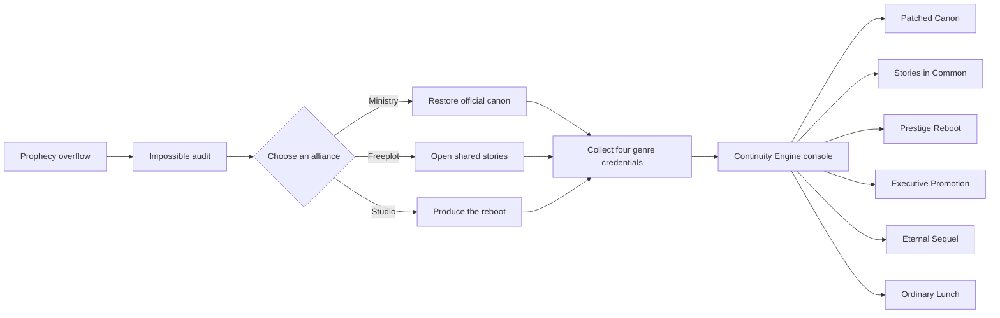
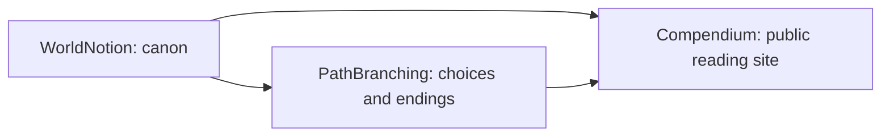

# The Grand Continuity — Everend Forge demo world

<p align="center"><a href="README.es.md">Español</a> · <a href="https://github.com/SoleipDreams/everend-forge-worldnotion/releases/latest">Download WorldNotion</a> · <a href="https://github.com/SoleipDreams/everend-forge-pathbranching/releases/latest">Download PathBranching</a> · <a href="https://github.com/SoleipDreams/everend-forge-compendium/releases/latest">Download Compendium</a></p>

<p align="center"></p>

An original, synthetic demonstration universe for Everend Forge. It shows how the same vault can be explored in WorldNotion, authored as a branching narrative in PathBranching, and published as a read-only site with Compendium.

The setting parodies broad genre conventions—space dynasties, wizard schools, collectible creatures, municipal superheroes, chosen-one prophecies, and corporate reboots—without using characters, names, settings, or lore from existing franchises.

## What is included

- A connected canon of characters, locations, organizations, items, creatures, concepts, and historical events.
- A custom Everend taxonomy and reusable entity templates.
- A modular PathBranching story named **The Last Acceptable Reboot**.
- Four major route families and six distinct endings.
- WorldNotion visual documents for a custom-calendar chronology and a character/institution relationship map.
- Numeric character attributes, canon character variants, character sheets, and a 1D20 skill check in PathBranching.
- A Compendium configuration that publishes canon and proposal material.
- A repository validator and GitHub Actions workflow.

## Application boundaries

| Application   | Example data in this repository                                                                               |
| ------------- | ------------------------------------------------------------------------------------------------------------- |
| WorldNotion   | `universe/The-Grand-Continuity.md`, linked entities, `Timelines/`, `Relationships/`, and `.everend/` metadata |
| PathBranching | `universe/.everend/.pathbranching/` story, character sheets and variants, plus a D20 skill check              |
| Compendium    | `universe/.everend/compendium.yaml`, the dated canon chronology, and the read-only narrative projection       |

## Story map



## Open it in Everend Forge

1. Clone or download this repository.
2. Choose the `universe/` folder once in Forge Suite. WorldNotion, PathBranching, and Compendium share that clean vault.
3. Start in WorldNotion with `universe/The-Grand-Continuity.md`, then open the chronology and relationship map.
4. Open PathBranching to author **The Last Acceptable Reboot**. Inspect the character sheets and the D20 audit check before following its six endings.
5. Open Compendium to read the same canon and its dated chronology, or build the static reader:

```bash
cd ../everend-forge-compendium
npx tsx cli/cli.ts build ../everend-forge-demworld/universe
```

## Validate the vault

```bash
npm install
npm test
```

The validator checks entity identity, taxonomy and Compendium metadata, PathBranching storage structure, canon references, transitions, branches, and the presence of multiple terminal endings.

The repository keeps its validator, dependencies, and license documents outside `universe/`, so applications index only the example world. Per-user editor preferences and transaction locks are stored under `universe/.everend/` and ignored by Git.

## Guía rápida en español

Este repositorio ofrece un universo de demostración completo. Abre `universe/` en Forge Suite para navegar el canon, la cronología y el mapa relacional en WorldNotion; editar rutas, fichas y tiradas en PathBranching; y leer la edición de Compendium. Todo el contenido es sintético y puede reutilizarse bajo CC BY 4.0.



## Support

If Everend Forge is useful to you, you can support its development on [Ko-fi](https://ko-fi.com/heinzdbv).

## License

The synthetic setting, stories, configurations, and documentation are CC BY 4.0. Preserve attribution and indicate changes when adapting them. See [license scope](LICENSE), [full license text](LICENSE-CC-BY-4.0), and the [brand policy](TRADEMARKS.md).
